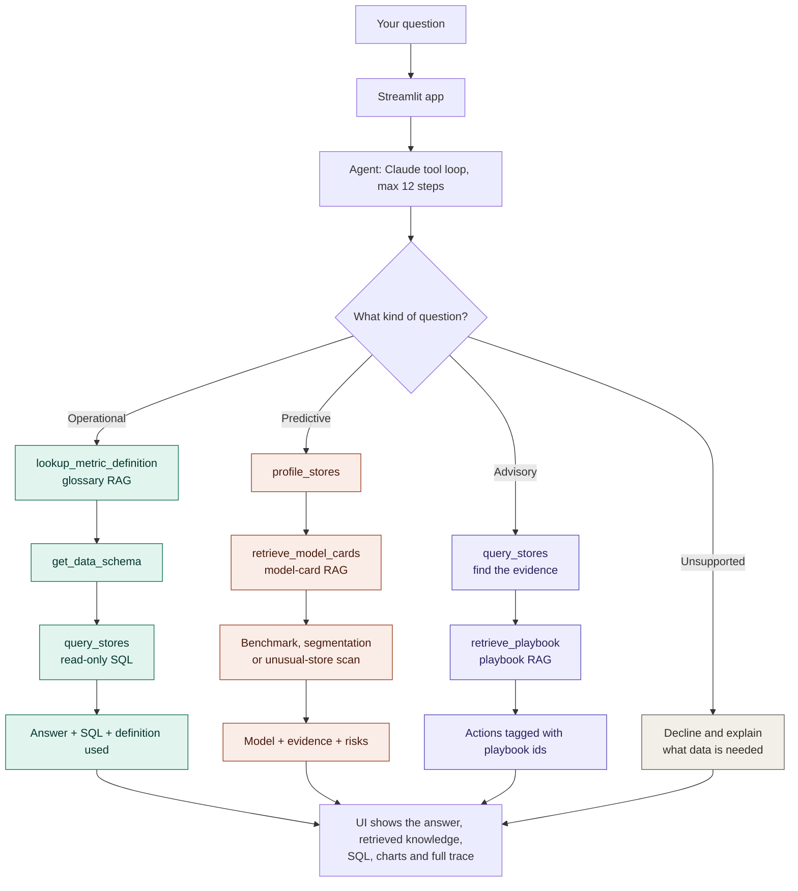
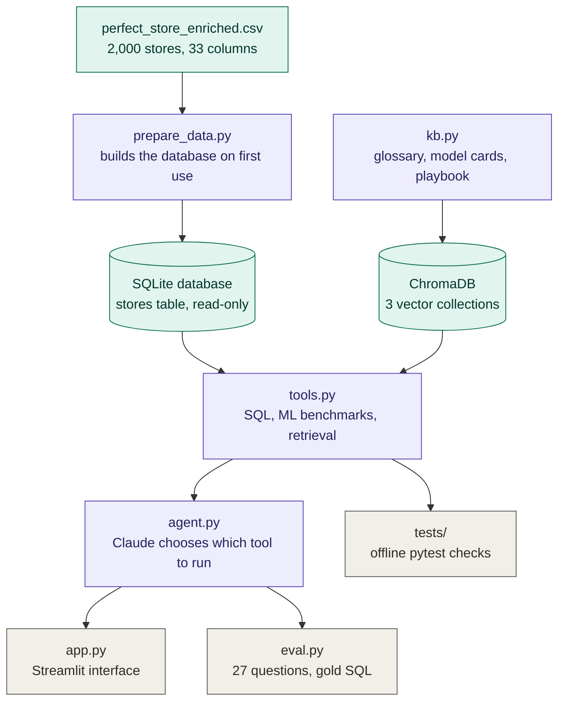
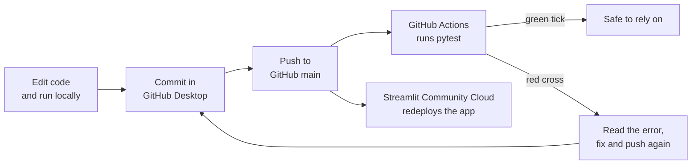

# Perfect Store Agent (Agentic RAG + Text-to-SQL + ML)
# Business IDEA and Outcome 
Using my experience in Retail Data : Synthesized Data to create a working RAG based Agent to not only answer operational questions ,based on Natural Language
choose a ML tool to predict sales and segmenation

This is a simplified natural-language assistant for retail execution teams, built on a 2,000-store Perfect Store audit. Ask a question and an agent built on Claude decides how to answer it, then shows its work.

| Question type | Example | What the agent does |
|---|---|---|
| **Operational** | "Which region has the lowest on-shelf availability?" | Retrieves the metric definition (RAG), reads the schema, writes read-only SQL, returns the answer with the SQL and definition used |
| **Predictive** | "Which KPIs best predict whether a store hits its sales target?" | Retrieves model cards (RAG), benchmarks models in Python, reports the winner, the baseline and the top drivers. Also segments stores and flags unusual ones. |
| **Advisory** | "Which stores should reps visit first, and what should they fix?" | Finds the evidence with SQL, retrieves guidance from the action playbook (RAG), recommends actions tagged with their source |
| **Unsupported** | "Which stores will decline next quarter?" | Declines and explains what data would be needed (here: monthly audit history) |

**Live demo:** https://perfect-store-agent-at5q3m6wfzwtqtlngj7sps.streamlit.app/ · **Demo video:** _add GIF_

## Workflow

### 1. What happens when you ask a question



### 2. How the project is built



### 3. From code change to live app




## Three RAG sources (all in `kb.py`)
| Source | Size | Purpose |
|---|---|---|
| Metric glossary | 17 definitions | OSA, perfect store score, "at-risk", "priority stores", "last month" mean one thing everywhere |
| Model cards | 8 cards | What each model needs, where it fails, which columns leak the answer |
| Action playbook | 11 entries | Causes, actions and tracking advice per KPI, so findings become recommendations |

The UI lists which entries were retrieved for each answer, so the RAG is visible and checkable. Collections rebuild automatically when you edit `kb.py`.

## Data and disclosure
The Perfect Store file is synthetic. Columns 17-33 come from `enrich_perfect_store.py`: some are derived from the original 16 columns and some are simulated with a fixed seed (retailer chain, field rep, store age, audit date, sales target and amounts, previous audit score). See `docs/perfect_store_data_dictionary.md`. Findings that depend on simulated columns demonstrate the pipeline; they are not business insights. ML features use only original columns and exclude leaky ones (`perfect_store_score`, `perfect_store`, `sales_vs_target_pct`, sales amounts). The playbook is generic industry guidance written for this demo, not validated against this data.

## Design
- **The LLM decides and explains; code computes.** Every number comes from a SQL result or an ML tool.
- **Safe SQL.** Read-only database connection, SELECT/WITH only, one statement, 10-second timeout, 50-row cap.
- **Honest scope.** Relative dates resolve against the last audit date. Unsupported questions are declined. Weak results (store segments overlap) are reported as weak. Feature importance is labelled association, not causation.
- **Measured.** `eval.py` scores task routing, operational answers against gold SQL, and advisory retrieval. `pytest` runs 33 offline checks in CI.

## Architecture
Question → Claude (tool loop, max 12 steps) → tools:
`lookup_metric_definition` · `get_data_schema` · `query_stores` (SQLite) · `profile_stores` · `retrieve_model_cards` · `retrieve_playbook` ·
`run_store_target_benchmark` · `run_store_segmentation_benchmark` · `find_unusual_stores`
→ structured answer → Streamlit shows the steps, retrieved knowledge, SQL, tables, charts and the full trace.

## Run it
```bash
python -m venv .venv && source .venv/bin/activate     # Windows: .venv\Scripts\activate
pip install -r requirements.txt pytest
export ANTHROPIC_API_KEY="your-key"                   # Windows: set ANTHROPIC_API_KEY=your-key

pytest -q                 # offline tests, no key needed (builds data/stores.db on first use)
python kb.py              # builds the three vector collections (downloads a small embedding model once)
python agent.py           # try the agent in the terminal
streamlit run app.py      # launch the UI
python eval.py            # 27-question evaluation (uses API credits)
```
Using your own raw 16-column file? `python prepare_data.py path/to/perfect_store.csv` adds the 17 derived and simulated columns for you.

## Project structure
```
agent.py        agent loop, system prompt, tool definitions
tools.py        SQL, profiling, ML and retrieval functions
kb.py           glossary, model cards, playbook (ChromaDB)
app.py          Streamlit UI
prepare_data.py builds data/stores.db from the CSV (automatic on first use)
enrich_perfect_store.py   derived and simulated columns
eval.py, eval_cases.py, eval_helpers.py   live evaluation
tests/          offline tests run by GitHub Actions
docs/           data dictionary
```

## Evaluation
Run `python eval.py` and paste the result, for example: _"Task routing X/27, operational answers vs gold SQL Y/12, advisory retrieval Z/4."_ The set has 12 operational questions with gold SQL, 6 predictive, 4 advisory and 5 that should be declined. Paste the failures and say what you fixed.

## Limitations
- One snapshot of 2,000 stores, so no time-series modelling and no decline prediction.
- Store segments overlap (silhouette about 0.14); the KPIs are close to independent.
- Rep, chain, sales amounts and previous score are synthetic.
- Anomaly detection has no labels, so it flags re-audit candidates, not errors.
- The playbook is generic guidance; recommendations are not proven for these stores.
- The answer check compares SQL results with gold SQL, not the wording of the final answer.
- Text-to-SQL can misread an ambiguous question; the UI shows the SQL so users can verify it.

## Future work
Monthly audit history (enables decline prediction), a before-and-after pilot dataset (enables impact estimates), conversation memory for follow-ups, a LangGraph router, a Power BI dashboard over the same table.

## Deploy
Push to GitHub, create the app on Streamlit Community Cloud, and add `ANTHROPIC_API_KEY = "..."` under Settings → Secrets. The database rebuilds itself from the committed CSV. If you see a SQLite version error from ChromaDB, add `pysqlite3-binary` to `requirements.txt` and put these lines at the top of `app.py`:
`__import__("pysqlite3"); import sys; sys.modules["sqlite3"] = sys.modules.pop("pysqlite3")`
